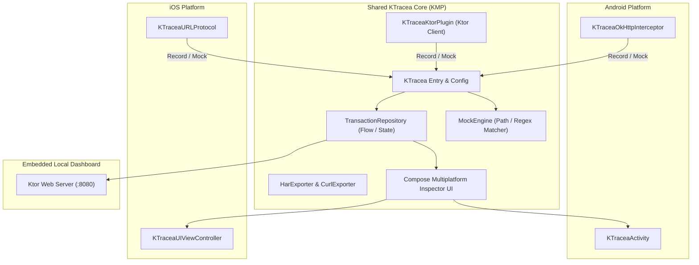

<p align="center">
  <h1 align="center">📡 KTracea</h1>
  <p align="center"><strong>Kotlin Multiplatform In-App Network Inspector, HTTP Debugger & API Mocking Engine</strong></p>
  <p align="center">
    <em>Inspect, debug, and mock network calls natively on Android & iOS with a unified Compose Multiplatform UI and local Wi-Fi web dashboard.</em>
  </p>
</p>

<p align="center">
  <a href="https://kotlinlang.org"></a>
  <a href="https://kotlinlang.org/docs/multiplatform.html"></a>
  <a href="https://www.jetbrains.com/lp/compose-multiplatform/"></a>
  <a href="https://jitpack.io/#sangram2006/tracea-kmp"></a>
  <a href="https://opensource.org/licenses/Apache-2.0"></a>
  <a href="https://github.com/sangram2006/tracea-kmp"></a>
</p>

---

## 📑 Table of Contents

- [The Problem & The Solution](#-the-problem--the-solution)
- [Key Features](#-key-features)
- [Comparison Matrix](#-comparison-matrix)
- [Architecture](#-architecture)
- [Installation](#-installation)
- [Quick Start Guide](#-quick-start-guide)
  - [1. Shared KMP (Ktor Client)](#1-shared-kmp-ktor-client)
  - [2. Android (OkHttp & Retrofit)](#2-android-okhttp--retrofit)
  - [3. iOS (SwiftUI & UIKit)](#3-ios-swiftui--uikit)
- [API Mocking Engine](#-api-mocking-engine)
- [Local Wi-Fi Web Dashboard](#-local-wi-fi-web-dashboard)
- [HAR Export & cURL Generation](#-har-export--curl-generation)
- [Production Safety (No-Op Module)](#-production-safety-no-op-module)
- [Configuration Options](#-configuration-options)
- [Sample App](#-sample-app)
- [Contributing](#-contributing)
- [Acknowledgements & Credits](#-acknowledgements--credits)
- [License](#-license)

---

## 💡 The Problem & The Solution

| The Old Way | The KTracea Way |
|---|---|
| **Fragmented Tooling**: Android used Chucker or Tracea; iOS used Pluto or Tracea-iOS. | **Unified Tooling**: One single multiplatform library shared across Android and iOS. |
| **Duplicate Mock Setups**: QA and devs had to re-create mock rules separately on Android and iOS. | **Shared Mock Rules**: Define mock rules once in shared Kotlin code or configure them on-device. |
| **Inconsistent Debug UIs**: Different look, feel, and features between platforms. | **Identical UI**: High-performance Compose Multiplatform inspector running natively on both platforms. |
| **Desktop Proxy Friction**: Charles / Proxyman require SSL certificates, root certificates, and proxy configs. | **Zero Proxy Config**: Intercepts requests internally directly inside the app runtime. |

---

## ✨ Key Features

- 📱 **Unified In-App Inspector (Compose Multiplatform)**:
  - Real-time stream of all HTTP/HTTPS transactions.
  - Filter by HTTP status (`ALL`, `2xx`, `4xx`, `5xx`, `MOCK`).
  - Search by endpoint URL, path, or HTTP method (`GET`, `POST`, `PUT`, `DELETE`).
  - Deep inspection: headers, request/response body with formatting, timings, and byte sizes.
- 🎭 **Dynamic API Mocking Engine**:
  - Intercept network requests matching URL regex or path substring.
  - Inject artificial latency delays (e.g. 500ms, 2000ms) to test loading states and timeouts.
  - Override status codes (e.g. `401 Unauthorized`, `500 Internal Server Error`).
  - Return custom mock JSON response bodies.
  - Create mock rules with **one tap** directly from any recorded request in the UI!
- 🌐 **Local Wi-Fi Web Dashboard**:
  - Embedded lightweight HTTP server running on port `8080`.
  - Open `http://<device-ip>:8080` in your desktop browser on the same Wi-Fi.
  - Live stream requests, view details, and export logs without touching the test device.
- 📤 **HAR 1.2 Export & cURL Copy**:
  - Export full traffic sessions to standard `.har` (HTTP Archive) format.
  - Easily import into Charles Proxy, Postman, Insomnia, or Proxyman.
  - Copy any request as a terminal-ready `curl` command.
- 🔒 **Sensitive Data Sanitization**:
  - Automatic masking of sensitive headers like `Authorization`, `Cookie`, and tokens.
- 🚫 **Production-Safe No-Op Module (`ktracea-noop`)**:
  - Complete zero-overhead stub module for release builds.
  - Strips all UI, storage, networking hooks, and server code from production releases.

---

## 📊 Comparison Matrix

| Feature | KTracea | Chucker | Pluto | Charles / Proxyman |
|---|:---:|:---:|:---:|:---:|
| **Platform** | **Android & iOS** | Android only | iOS only | Desktop (Proxy) |
| **KMP Native (Ktor)** | ✅ | ❌ | ❌ | N/A |
| **Compose Multiplatform UI** | ✅ | ❌ | ❌ | ❌ |
| **API Mocking** | ✅ | ❌ | Limited | ✅ |
| **Latency Simulation** | ✅ | ❌ | ❌ | ✅ |
| **Local Web Dashboard** | ✅ | ❌ | ❌ | N/A |
| **HAR 1.2 Export** | ✅ | ✅ | ✅ | ✅ |
| **No SSL Certificate Setup** | ✅ | ✅ | ✅ | ❌ |
| **Production No-Op Variant**| ✅ | ✅ | ✅ | N/A |

---

## 🏛 Architecture



---

## 📦 Installation

### 1. Add the JitPack repository
In your root `settings.gradle.kts`:

```kotlin
dependencyResolutionManagement {
    repositories {
        google()
        mavenCentral()
        maven { url = uri("https://jitpack.io") }
    }
}
```

### 2. Add dependencies

In your shared module or app-level `build.gradle.kts`:

```kotlin
kotlin {
    sourceSets {
        commonMain.dependencies {
            // For shared KMP code
            implementation("com.github.sangram2006.tracea-kmp:ktracea:1.0.0")
        }
        
        // Or configure debug / release split for Android:
        androidMain.dependencies {
            // Debug build gets full inspector
            // Release build gets zero-overhead no-op
        }
    }
}

// In Android application build.gradle.kts:
dependencies {
    debugImplementation("com.github.sangram2006.tracea-kmp:ktracea:1.0.0")
    releaseImplementation("com.github.sangram2006.tracea-kmp:ktracea-noop:1.0.0")
}
```

---

## 🚀 Quick Start Guide

### 1. Shared KMP (Ktor Client)

If your app uses **Ktor Client** in `commonMain`, install the `KTraceaKtorPlugin`:

```kotlin
import com.mobile.ktracea.ktor.KTraceaKtorPlugin
import io.ktor.client.HttpClient
import io.ktor.client.plugins.contentnegotiation.ContentNegotiation
import io.ktor.serialization.kotlinx.json.json

val httpClient = HttpClient {
    install(KTraceaKtorPlugin)
    install(ContentNegotiation) {
        json()
    }
}
```

Any network request made through `httpClient` will automatically appear in the KTracea inspector and be subject to active mock rules!

---

### 2. Android (OkHttp & Retrofit)

#### Add the Interceptor
Add `KTraceaOkHttpInterceptor` to your `OkHttpClient.Builder`:

```kotlin
import com.mobile.ktracea.android.KTraceaOkHttpInterceptor
import okhttp3.OkHttpClient

val okHttpClient = OkHttpClient.Builder()
    .addInterceptor(KTraceaOkHttpInterceptor(context))
    .build()
```

#### Launch the Inspector UI
Open the inspector anytime from a debug menu, floating button, or shake gesture:

```kotlin
import com.mobile.ktracea.android.KTraceaAndroid

// Launch inspector Activity:
KTraceaAndroid.openInspector(context)
```

---

### 3. iOS (SwiftUI & UIKit)

#### Embed Compose Inspector in SwiftUI
Use `UIViewControllerRepresentable` to display the inspector directly in your iOS app:

```swift
import SwiftUI
import KTracea

struct KTraceaInspectorView: UIViewControllerRepresentable {
    @Environment(\.dismiss) private var dismiss

    func makeUIViewController(context: Context) -> UIViewController {
        return KTraceaIOS.shared.createViewController {
            dismiss()
        }
    }

    func updateUIViewController(_ uiViewController: UIViewController, context: Context) {}
}

// Present via sheet:
struct ContentView: View {
    @State private var showInspector = false

    var body: some View {
        Button("Open Network Inspector") {
            showInspector = true
        }
        .sheet(isPresented: $showInspector) {
            KTraceaInspectorView()
        }
    }
}
```

---

## 🎭 API Mocking Engine

KTracea features a built-in mock engine that intercepts outgoing requests and serves simulated responses:

### Define Mocks in Code

```kotlin
import com.mobile.ktracea.mock.MockEngine
import com.mobile.ktracea.model.MockRule
import com.mobile.ktracea.model.HttpHeader

// 1. Mock a user endpoint with artificial latency:
MockEngine.addRule(
    MockRule(
        id = "mock_user_profile",
        urlPattern = "/v1/users/me",
        method = "GET",
        responseCode = 200,
        responseBody = """
            {
              "id": "usr_9988",
              "name": "Alex Mercer",
              "email": "alex@example.com",
              "tier": "VIP"
            }
        """.trimIndent(),
        delayMs = 800L // Simulate 800ms network delay
    )
)

// 2. Mock a 500 error on checkout to test failure UI:
MockEngine.addRule(
    MockRule(
        id = "mock_payment_failure",
        urlPattern = ".*/orders/checkout",
        method = "POST",
        responseCode = 500,
        responseBody = """{"error": "Payment gateway timeout"}"""
    )
)
```

### Configure Mocks On-Device
You can also open the **Mocks** tab in the in-app inspector to create, toggle, edit, or delete rules without recompiling the app!

---

## 🌐 Local Wi-Fi Web Dashboard

Debug your app from the comfort of your computer screen without connecting a cable:

1. Enable the dashboard in configuration (enabled by default on port `8080`).
2. Make sure your computer and mobile device are on the same Wi-Fi network.
3. Find your device's local IP (e.g. `192.168.1.15`).
4. Open your browser:
   ```
   http://192.168.1.15:8080
   ```
5. View streaming transactions, copy cURL, filter by status, and export `.har` files directly from your desktop!

---

## 📤 HAR Export & cURL Generation

### Export to HAR (HTTP Archive)
```kotlin
import com.mobile.ktracea.KTracea
import com.mobile.ktracea.export.HarExporter

val transactions = KTracea.repository.transactions.value
val harJsonString = HarExporter.exportToHar(transactions)
// Save to file or share via intent/AirDrop
```

### Export to cURL
```kotlin
import com.mobile.ktracea.export.CurlExporter

val curlCommand = CurlExporter.exportToCurl(transaction)
// e.g.: curl -X POST -H "Content-Type: application/json" --data '{"qty":1}' "https://api.example.com/cart"
```

---

## 🚫 Production Safety (No-Op Module)

Never worry about leaking debug endpoints or adding binary bloat to production builds. The `:ktracea-noop` artifact provides identical APIs with empty bodies:

```kotlin
// In your build.gradle.kts:
dependencies {
    debugImplementation("com.github.sangram2006.tracea-kmp:ktracea:1.0.0")
    releaseImplementation("com.github.sangram2006.tracea-kmp:ktracea-noop:1.0.0")
}
```

In release builds:
- 0 background threads or Ktor server instances.
- 0 disk or in-memory transaction logs.
- All Compose UI code is stripped from the APK/IPA.
- The interceptor simply forwards calls directly with 0 latency overhead.

---

## ⚙️ Configuration Options

Initialize KTracea with custom preferences:

```kotlin
import com.mobile.ktracea.KTracea
import com.mobile.ktracea.model.KTraceaConfig

KTracea.configure(
    KTraceaConfig(
        maxTransactions = 1000,          // Maximum transactions kept in memory
        webServerEnabled = true,          // Enable Wi-Fi web dashboard
        webServerPort = 8080,             // Port for the web dashboard
        mockingEnabled = true,            // Enable or disable mock engine globally
        sanitizeHeaders = listOf(         // Mask sensitive headers in logs
            "Authorization",
            "Cookie",
            "Set-Cookie",
            "X-Api-Key"
        )
    )
)
```

---

## 📱 Sample App

A complete working sample application is included in the [`:sample`](file:///Users/smohanty/vscorp/vscoandroid/tracea-kmp/sample) module:

- Demonstrates simulated network requests (200 success, 404 not found, error).
- Demonstrates launching the Compose Multiplatform inspector.
- To run on Android:
  ```bash
  ./gradlew :sample:installDebug
  ```

---

## 🤝 Contributing

Contributions are very welcome! If you'd like to improve KTracea:
1. Fork the repository.
2. Create your feature branch (`git checkout -b feature/amazing-feature`).
3. Commit your changes (`git commit -m 'Add amazing feature'`).
4. Push to the branch (`git push origin feature/amazing-feature`).
5. Open a Pull Request.

---

## 👏 Acknowledgements & Credits

- Inspired by and based on the original **Tracea** Android and iOS libraries created by [Hari Kulhari](https://github.com/HariKulhari06) and team:
  - [HariKulhari06/tracea](https://github.com/HariKulhari06/tracea) (Android)
  - [HariKulhari06/tracea-ios](https://github.com/HariKulhari06/tracea-ios) (iOS)
- Kotlin Multiplatform edition designed and maintained by [Sangram Mohanty](https://github.com/sangram2006).

---

## 📄 License

```
Copyright 2026 Sangram Mohanty

Licensed under the Apache License, Version 2.0 (the "License");
you may not use this file except in compliance with the License.
You may obtain a copy of the License at

    http://www.apache.org/licenses/LICENSE-2.0

Unless required by applicable law or agreed to in writing, software
distributed under the License is distributed on an "AS IS" BASIS,
WITHOUT WARRANTIES OR CONDITIONS OF ANY KIND, either express or implied.
See the License for the specific language governing permissions and
limitations under the License.
```
